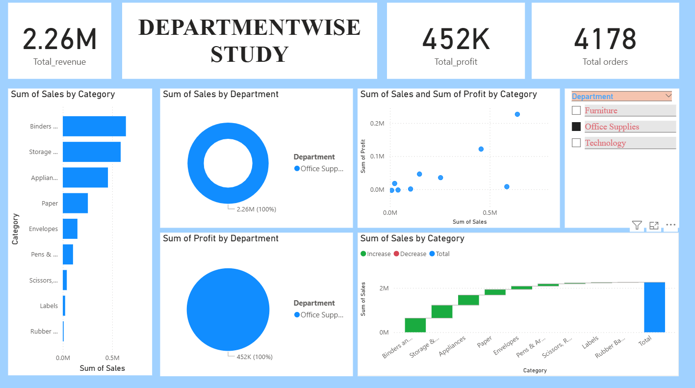

# Superstore Data Analysis Dashboard

## Project Overview
This project focuses on analyzing Superstore sales data using Microsoft Power BI. The dashboard provides insights into revenue, profit, quantity, orders, categories, regions, and customer segments.

## Dashboard KPIs
- Total Revenue: 263.14K
- Total Profit: 23K
- Total Quantity: 2,023
- Total Orders: 141

## Key Features
- Sales and Profit Analysis
- Category-wise Sales Analysis
- Regional Sales Analysis
- Customer Segment Analysis
- Monthly and Quarterly Trends
- Department-wise Sales and Profit Analysis
- Interactive Dashboard Visualizations

## Tools & Technologies
- Microsoft Power BI
- Power Query
- DAX
- Microsoft Excel
- Data Cleaning
- Data Visualization

## Dashboard Screenshots

### Main Dashboard

### Department-wise Dashboard

## Learning Outcomes
- Data Cleaning and Transformation
- KPI Development
- Interactive Dashboard Creation
- Business Intelligence
- Sales Performance Analysis

## Conclusion
This project helped me understand business performance through interactive data visualization and analytical insights.

